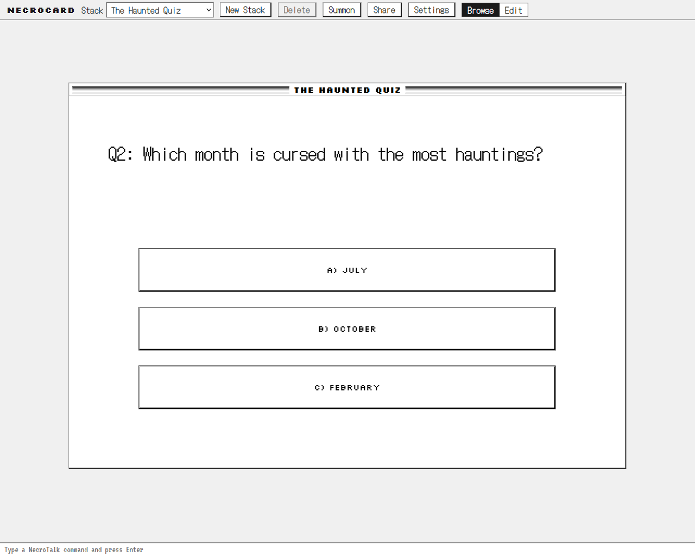
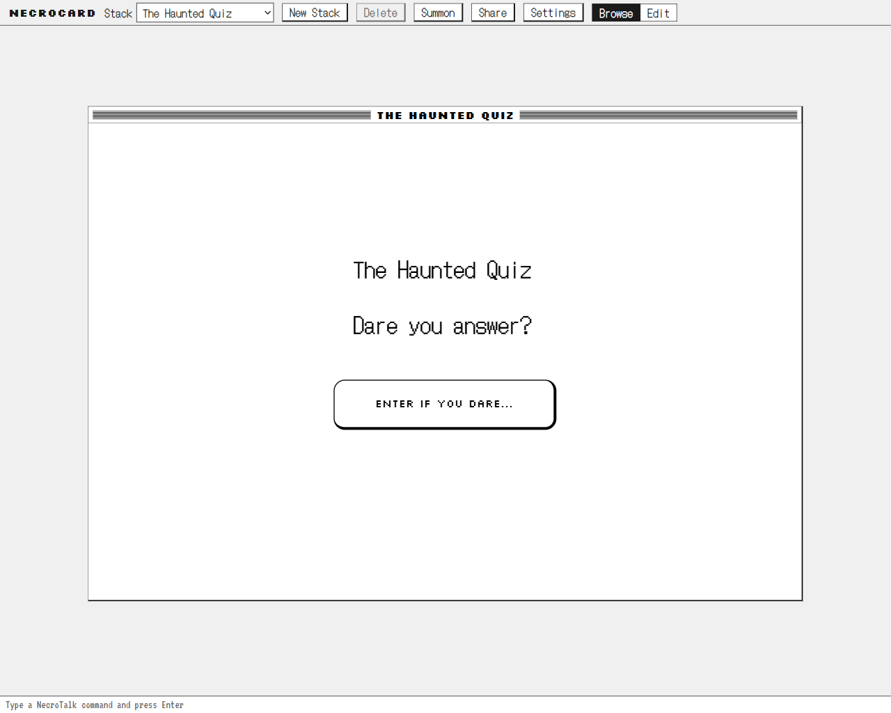
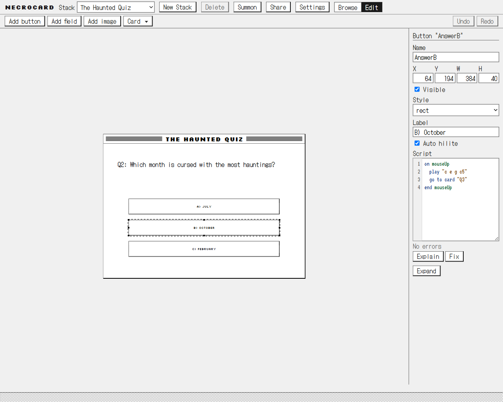
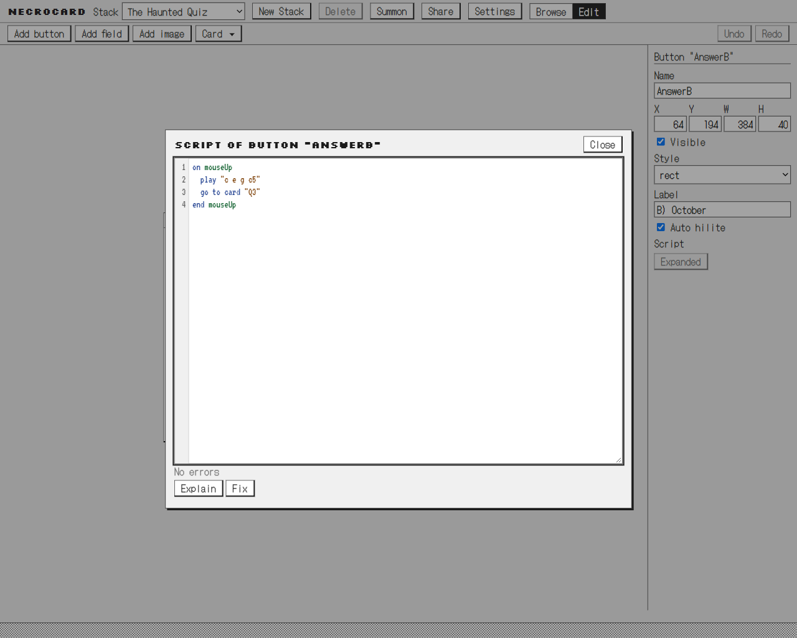
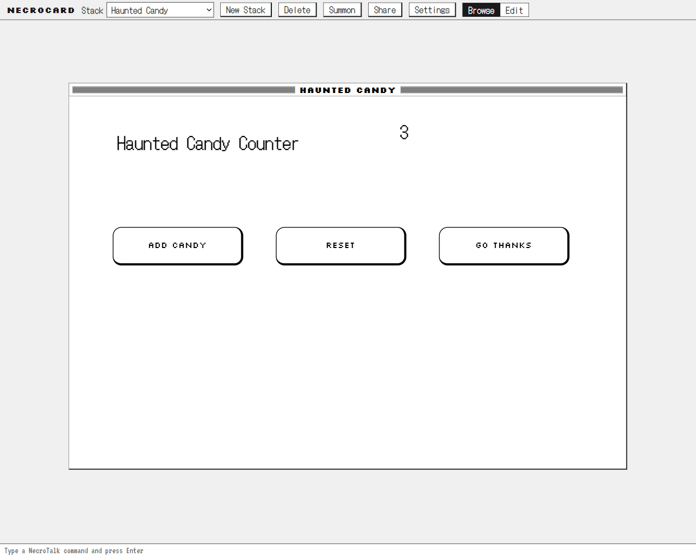

# NecroCard

**HyperCard, raised from the dead.** Describe a stack in plain English and NecroCard builds the cards, buttons,
fields, and HyperTalk-style scripts. Then click through it, edit it, and share it by URL.

Built for **Kiroween 2026**, category **Resurrection**, with [Kiro](https://kiro.dev).

> Live at **[necrocard.onrender.com](https://necrocard.onrender.com)**.



## What it is

HyperCard (1987 to 2004) let anyone build interactive software by stacking cards, dropping buttons and fields onto
them, and writing small English-like scripts. NecroCard brings that model back in the browser. A **stack** holds a
shared **background** and a sequence of **cards**; each card carries buttons, fields, and images, and every object
has properties and a script. Scripts are written in **NecroTalk**, a frozen subset of HyperTalk: handlers, card
navigation, `put`/`get`/`set`, `if`/`repeat`, `answer`/`ask`, visual effects, and a one-voice `play`. The one thing
1987 did not have is **Summon**: type a description and an agent writes a working stack, scripts included, which you
can then click through, edit, or ask the agent to explain and fix.

## Screenshots



The default stack opens on its title card, drawn in 1-bit black and white at the original Mac size.



Edit mode: select, move, and resize objects, and change their properties in the inspector.



The script editor shows a real NecroTalk script with syntax colours and inline error checking.



A stack Summoned from a short plain-English prompt, with working buttons and a live counter field.

All seven shots, and how to retake them, are in [`docs/screenshots/gallery/`](docs/screenshots/gallery/README.md).

## 60-second quick start

Requires Node 22.9 or later.

```
git clone https://github.com/UBayouski/NecroCard.git
cd NecroCard
npm ci
npm run dev        # http://localhost:5173
npm test           # unit and property tests (Vitest + fast-check)
npm run e2e        # end-to-end tests (Playwright)
```

The three bundled sample stacks (quiz, adventure, flashcards) run with no server and no AI calls. Other commands:
`npm run build`, `npm run typecheck`, `npm run lint`. Summon, Explain, and Fix are optional and call Google Gemini
through the Node server in `server/`; see "Running Summon locally" below.

## NecroTalk at a glance

NecroTalk is a deliberately frozen HyperTalk subset; anything not on the list is out of scope by design. It covers:

- **Handlers and messages.** `on <handler> ... end <handler>` for `mouseUp`, `mouseDown`, `openCard`, `closeCard`,
  `openStack`, plus custom handlers called by name. Messages pass object → card → background → stack; `pass` hands
  the message up, and `me` follows the chain.
- **Navigation.** `go to card N` / `"Name"`, `go next | prev | first | last`, with a `visual effect`
  (dissolve, wipe left, wipe right, scroll up) applied to the next `go`.
- **Data and properties.** `put`/`get`/`set` over `field "Name"`, variables, and `it`; `global` declarations;
  object references `button`/`field`/`image`/`card`/`me` with expression names; a field in expression position
  reads its text; `the date` / `the time`.
- **Control flow.** `if ... then` (single line or block with `else if`/`end if`), the three `repeat` forms,
  `exit`/`next repeat`/`exit repeat`.
- **Expressions.** Arithmetic `+ - * / mod ^` and unary minus, concatenation `&`/`&&`, comparisons and
  `is`/`is not`/`contains`, logic `and`/`or`/`not`, grouping parentheses, chunk and counting functions
  (`word`/`line`/`char`, `the number of ...`), and `random`/`length`.
- **Feedback.** `answer`/`ask` dialogs, `show`/`hide`, `beep`, and `play "<notes>"` (one synthesized square-wave
  voice).

The interpreter is DOM-free and throws `Line N:` errors. The complete frozen grammar, including what is out of
scope, is in [`docs/BRIEF.md`](docs/BRIEF.md) section 4.

## Fonts

The three bundled bitmap-style fonts, their designers, and their licenses (SIL Open Font License 1.1) are listed in
[`src/assets/fonts/FONTS.md`](src/assets/fonts/FONTS.md).

## Running Summon locally

Summon, Explain, and Fix call Google Gemini through a small Node server in `server/`. The app works without it: the
sample stacks need no AI calls.

1. Get a Gemini API key in [Google AI Studio](https://aistudio.google.com/apikey).
2. Copy `.env.example` to `.env` and set `GEMINI_API_KEY`. `.env` is ignored by git; never commit it.
3. Start the server: `npm run server:dev` (builds to `dist-server/` and listens on port 8787; Node 22.9+).
4. Start the app in a second terminal: `npm run dev`. Vite proxies `/api` to `http://localhost:8787`.

Check the server with `GET http://localhost:8787/api/health`: `"ok": true` means a key is set. The server caps
requests per UTC day (`DAILY_CAP`, default 100) and per IP (`PER_IP_CAP`, default 10); the counters live in memory
and reset when it restarts. Alternatively, paste your own key in the app's Settings: it stays in this browser's
local storage and is sent only to Google.

## Hosting

`render.yaml` is a Render Blueprint with a single free Node web service, `necrocard`. Its build runs
`npm ci && npm run build && npm run server:build`, and `npm run server:start` then runs one `node:http` process
that serves the built app from `dist/` on every path except `/api/*`, which the Summon handler answers (health
check `/api/health`). Hashed files under `/assets/` are sent as immutable; everything else is revalidated.

In the Render dashboard, create a Blueprint from this repository, then set `GEMINI_API_KEY` on the service (it is
marked `sync: false`, so the key is never stored in the repo). The app and the API share one origin, so nothing in
the blueprint depends on the hostname: the server accepts any `Origin` that matches its own `Host` header, and the
app calls `/api` relative to the page. The free web service sleeps after 15 minutes without traffic, so the first
page load after a pause takes up to about a minute.

To run the production layout locally: `npm run build`, then `npm run server:dev` and open
`http://localhost:8787`.

## Built with Kiro

NecroCard was built with Kiro. Everything Kiro used lives in [`.kiro/`](.kiro/):

- **12 specs** in [`.kiro/specs/`](.kiro/specs/) — requirements, design, and tasks for stack-model,
  necrotalk-interpreter, browse-mode, edit-mode, script-editor, summon, sharing, retro-skin, stack-library,
  edit-background, necrotalk-play, and single-service-hosting.
- **5 steering docs** in [`.kiro/steering/`](.kiro/steering/) — product, tech, and structure always on, with
  `necrotalk.md` and `retro-ui.md` scoped to their folders (`retro-ui.md` also holds the rule that keeps the
  screenshot gallery current).
- **3 hooks** in [`.kiro/hooks/`](.kiro/hooks/) — tests on save, typecheck and lint before finishing a task, and a
  task-done chime.
- **1 custom agent** in [`.kiro/agents/`](.kiro/agents/) — the read-only `necrotalk-reviewer` that checks the
  interpreter against the brief and steering.
- **MCP** in [`.kiro/settings/mcp.json`](.kiro/settings/mcp.json) — the Playwright server used for the in-browser
  smoke runs.

As of 2026-11-05, the build is backed by 1079 unit tests across 73 files (Vitest with fast-check property tests) and
29 end-to-end tests across 9 Playwright specs, all passing. The full session-by-session log of how Kiro was used is
in [`KIRO_USAGE.md`](KIRO_USAGE.md).

The Playwright MCP server in `.kiro/settings/mcp.json` is configured for Windows, where `npx` is a script and must
run through `cmd /c`. On macOS or Linux, change `"command"` to `"npx"` and drop `"/c"` and `"npx"` from `args`.

## Disclosure

NecroCard was created from scratch during the Kiroween 2026 submission period (October 30 to December 4, 2026).
It uses standard open source frameworks and libraries only; no other pre-existing code is incorporated.

## License

MIT. See [LICENSE](LICENSE).
